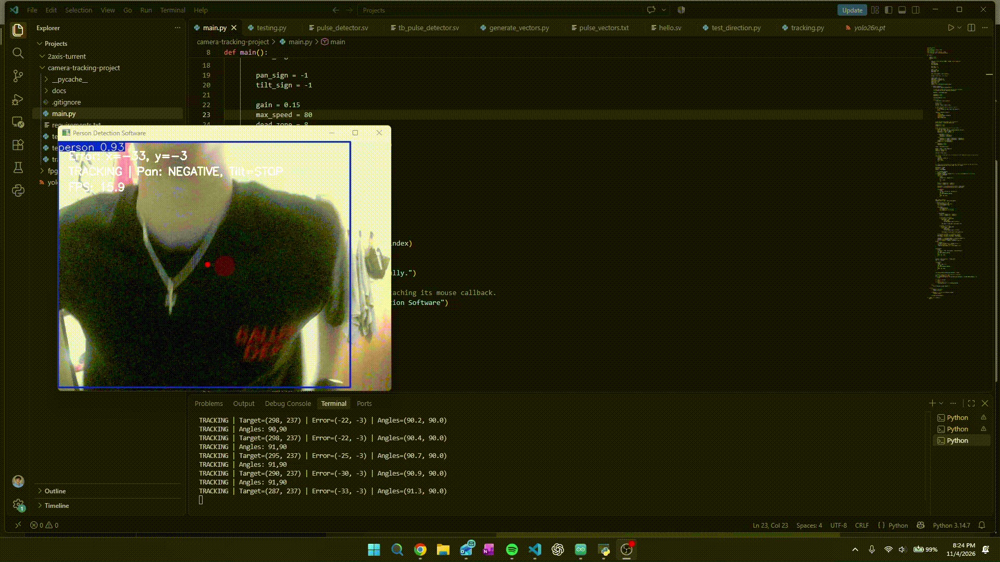

# Person Tracking Camera Documentation

Author: Parker Wilson  
Revision: 1.12 | November 4, 2026

Open **Person_Tracking_Project_Guide.pdf** for the complete guide. The Markdown
version is editable and suitable for adapting into a repository README.

## Quick start

1. Verify servo power, shared ground, pan signal on Uno pin 9 and tilt on pin 10.
2. Back up the currently working Arduino sketch.
3. Upload the included reference receiver only after reviewing home and limits.
4. With Python stopped, send `40,40`, `45,40`, and `40,45` separately in Serial
   Monitor at 115200 baud with Newline. Confirm axis direction and clearance.
5. Close Serial Monitor, match Python home and limits, and select the actual COM port.
6. Verify that each direction sign makes the corresponding image error shrink.

## Status

Basic servo movement was reported working. Vision and serial commands appear in
the supplied logs. Final tracking performance on both axes remains unverified.
40,40 is the latest owner-selected home. 30-150 are the documented command limits.
The suggested 8px dead zone and direction changes require hardware validation.

The reference firmware is consolidated documentation code; it has not been
compiled or hardware-tested during preparation of this package. It holds the
last accepted angle when commands stop and has no watchdog or acknowledgment.
No model weights or replacement Python application are included.

## Sources
* [3D model for base](https://makerworld.com/en/models/973248-pan-tilt-servo-antenna-tracker-mg996r#profileId-945437)
* [YOLO Script (My own personal work)](https://github.com/wilsopar/camera-tracking-project)
* [Wiring Assistance](https://forum.arduino.cc/t/why-arent-my-servos-moving/853622/6) 
